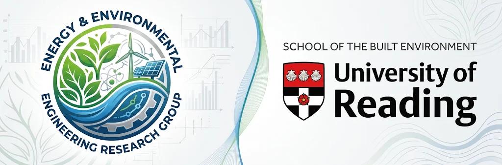

  <!-- Replace the src URL below with the path to your uploaded logo in this repo, e.g., ./assets/logo.png -->
  

  # Energy and Environmental Engineering Research Group
  **School of the Built Environment | University of Reading**

  
  

---

### 🌍 About Us

We are an interdisciplinary research group within the **School of the Built Environment** at the **University of Reading**. Our work focuses on addressing real-world challenges in the design, construction, and operation of sustainable buildings and urban environments. 

This GitHub organisation hosts open-source models, data processing pipelines, simulation tools, and reproducible research code developed by our researchers and collaborators.

### 🔬 Core Research Areas

* **Energy Systems & Demand Flexibility:** Building-level energy demand modelling, power network operations, and demand-side management to support energy transitions.
* **Building & Urban Environments:** Enhancing indoor/outdoor environmental quality and developing urban green infrastructure.
* **Future Technologies & Climate Nexus:** Investigating future energy technology portfolios and the complex interactions between urban climate, energy, and environmental systems.

### 📂 What You'll Find Here

* **Simulation & Modelling Tools:** Codebases for building physics, urban microclimate, energy demand and grid modelling.
* **Data & Analytics:** Scripts and datasets supporting empirical research into energy demand and environmental performance.
* **Research Reproducibility:** Companion repositories for our peer-reviewed publications and active research grants (including contributions to programmes such as the [**Energy Demand Research Centre**](https://www.edrc.ac.uk/)).

### 🤝 Collaborations & Contact

We actively engage with industry partners, policymakers, and fellow academic institutions. 

* **Group Webpage:** [research.reading.ac.uk/energy-environmental-engineering](https://research.reading.ac.uk/energy-environmental-engineering/)
* **People & Projects:** View our [Active Projects](https://research.reading.ac.uk/energy-environmental-engineering/projects/) and [Researchers](https://research.reading.ac.uk/energy-environmental-engineering/meet-our-researchers/)
* **Email:** [sbe@reading.ac.uk](mailto:sbe@reading.ac.uk)